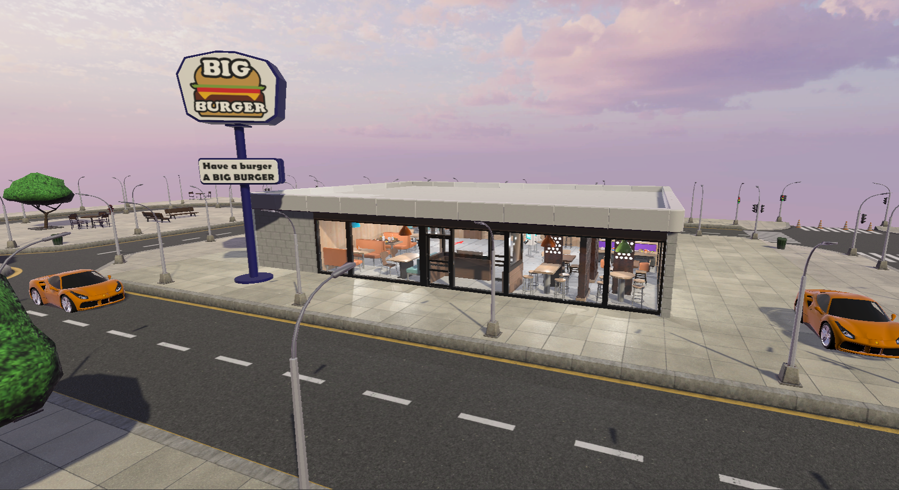
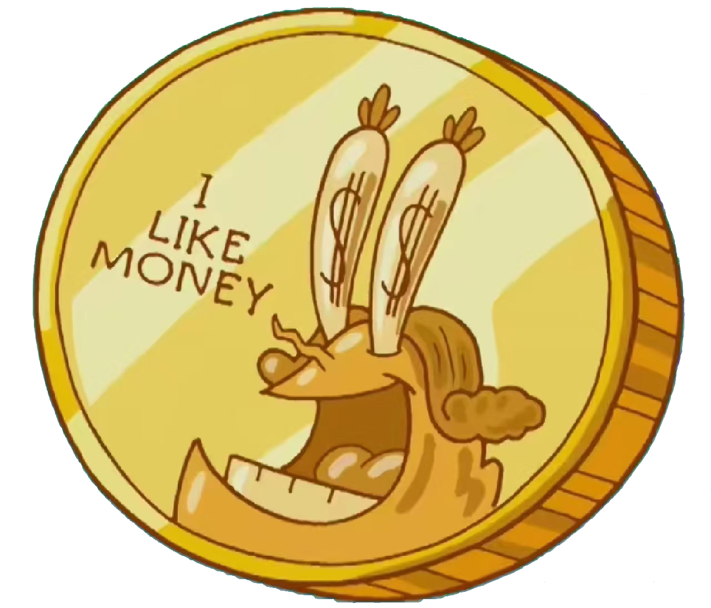
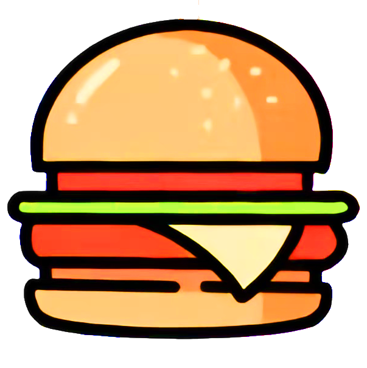

# 美食创业家

一款以快餐店经营为主题的 Unity 第一人称模拟游戏。玩家从一家快餐店开始经营，通过接待顾客、识别订单、制作餐品、交付食物和维护环境获得收入，并在工作与休息之间推进游戏时间。项目由本人独立完成。

## 项目概览

- **项目类型**：快餐店经营模拟 / 第一人称互动体验
- **开发引擎**：Unity 2020.3.48f1c1
- **开发语言**：C#
- **个人角色**：独立完成 UI 设计、美术设计、特效构思、音效制作、剧情设计、玩法策划、程序开发与测试
- **项目时间**：2024 年 11 月

## 核心玩法

1. **顾客与点餐系统**：NPC 会进入餐厅、闲逛并随机点餐；玩家需要观察订单内容并制作对应餐品。
2. **食品制作与交付**：通过 J、K、L 键触发不同烹饪技能；将正确餐品交付给正在点餐的顾客后获得金币，错误或无订单时不会产生收入。
3. **环境清洁**：工作一段时间后餐厅会生成垃圾，玩家需要找到并点击垃圾完成清理，同时触发清扫音效与特效。
4. **工作与休息循环**：点击“上班”开始营业并显示烹饪技能，点击“下班”结束工作；回家休息可以保存进度并进入下一天。
5. **场景移动**：通过传送阵在家与快餐店之间移动，并通过边界空气墙限制玩家活动范围。
6. **顾客分流**：当一名 NPC 正在柜台点餐时，其他 NPC 会继续在餐厅内活动，避免顾客在柜台堆叠。

## 实现亮点

- 使用事件广播与监听传递 NPC 的订单类型，并在交付餐品时进行类型匹配，只有正确餐品才会触发金币奖励和订单完成逻辑。
- 使用单例模式集中管理金币数据，保证不同交互对象之间的数据共享和保存一致性。
- 使用协程和 `Invoke` 控制门、面板等交互动画及延时提示，形成更明确的操作反馈。
- 将 UI 提示、音效、粒子特效和场景交互结合，强化制作餐品、交付订单和清理垃圾等关键节点的反馈。

## Demo 演示

### 玩法演示视频

玩法演示视频会上传到 GitHub Release，展示从开始营业、接收订单、制作餐品、交付顾客到获得金币的完整操作流程。Release 附件名为 `Food-Entrepreneur-gameplay-demo.mp4`（约 74.5 MB）：

- [下载 / 观看游戏玩法演示视频（Release）](https://github.com/gouxiana/Food-Entrepreneur-unity/releases/tag/v1.0-demo)

### 剧情介绍视频

该视频用于介绍项目背景和游戏设定，不等同于实际玩法录屏：

- [查看项目剧情介绍视频](media/food-entrepreneur-demo.mov)

### Windows 可执行 Demo

- [下载 Windows 可执行 Demo（Release）](https://github.com/gouxiana/Food-Entrepreneur-unity/releases/tag/v1.0-demo)

运行步骤：

1. 在 Release 页面下载 `Food-Entrepreneur-v1.0-Windows.zip`。
2. 将压缩包完整解压到本地文件夹，不要只单独解压 exe 文件。
3. 双击 `美食创业家.exe` 启动游戏。

## 项目展示

### 餐厅场景



### 订单与金币反馈素材



### 餐品素材

  

### 工作状态按钮

 

## 仓库内容

```text
README.md
media/
  food-entrepreneur-story.mov
screenshots/
  restaurant-scene.png
  coin-feedback.png
  burger-icon.png
  fries-icon.png
  drink-icon.png
  start-work-button.png
  finish-work-button.png
```

Windows 打包文件较大，因此放在 GitHub Release 中管理；仓库分支保留 README、截图和录屏，便于快速浏览项目内容。

## 项目复盘

项目已完成 NPC 点餐、食品制作、订单匹配、金币奖励、清洁互动、时间切换、保存和传送等核心功能。后续可以继续扩展 NPC 对话、餐厅升级、商店系统和更复杂的 NPC 行为决策，并进一步优化大量餐品同时生成时的稳定性和场景物件的可交互范围。
